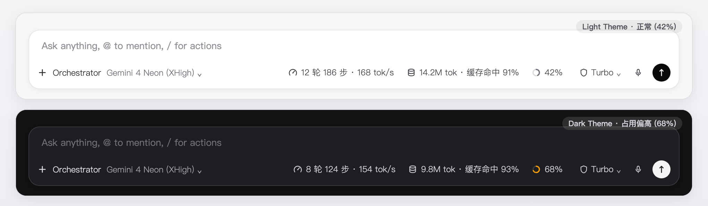
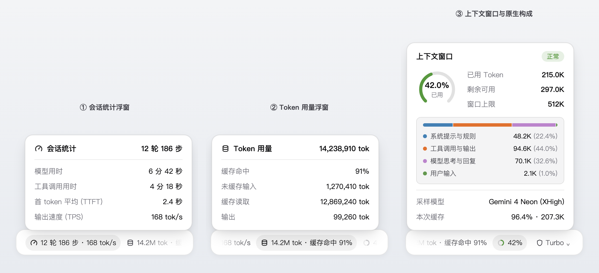
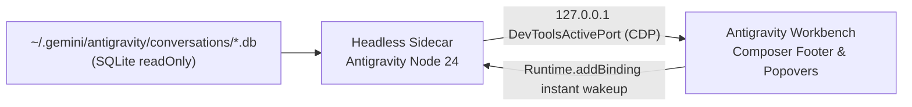

<div align="center">


# agy-ctx-ring

**Zero-patch native composer HUD & click popovers for Antigravity — session stats, token usage, and native context breakdown.**

[](https://github.com/XMT-CN/agy-ctx-ring/releases/latest)
[](./LICENSE)
[](#architecture--privacy)
[](#quick-start)

**English** | [简体中文](./README.zh-CN.md)

</div>

---

## Preview

Mounted directly inside Antigravity's composer footer to the left of the `Turbo` trigger — borderless, responsive, and automatically inheriting Light/Dark CSS tokens and Google Sans Flex typography:

<p align="center">
  
</p>

Clicking any of the three segments opens a compact floating popover right above the composer:

<p align="center">
  
</p>

- **Session Stats (`会话统计`)**: turns, steps, model wall time, deduplicated tool call wall time, average TTFT, and decode speed (`tok/s`).
- **Token Usage (`Token 用量`)**: cumulative total tokens, cache hit rate, uncached input, cache read, and output tokens.
- **Context Window (`上下文窗口`)**: ring progress (`正常` / `占用偏高` / `接近上限`), used / remaining / window cap, plus the **exact 4-category breakdown** decoded from Antigravity's native `gen_metadata` (`系统提示与规则` · `工具调用与输出` · `模型思考与回复` · `用户输入`).

---

## Features

- **Zero-Patch Upgrade Survival**: Never modifies `Antigravity.app`, `app.asar`, or `~/.gemini/config/config.json`. Installed cleanly under `~/.gemini/config/plugins/agy-ctx-ring/` so official Antigravity updates never wipe your HUD.
- **API Ground-Truth Prompt Usage & Native Breakdown**: Tracks server-returned prompt tokens (`uncached input + cache read`, aligned with Antigravity's actual compaction trigger) and scales the 4-category breakdown from Antigravity's native `gen_metadata` context tree (`ctx[3]`).
- **Zero-Latency Session Switching**:
  - Preloads the 40 most recent conversations into browser memory on attach;
  - Hooks Chromium `window.navigation` (`currententrychange`), `popstate`, and a `queueMicrotask` `MutationObserver` to re-render in the same paint frame (~0 ms);
  - Registers a CDP `Runtime.addBinding` wakeup channel so fresh SQLite metrics sync in ~5–15 ms without waiting for polling intervals.
- **Instant New-Chat Reset**: Resets cleanly to `0 轮 0 步 · 0 tok · 0%` on `/` or before a conversation `.db` exists (no stale data leaked from previous chats).
- **Headless Sidecar (`has_web_ui: false`)**: Adds zero extra sidebar tabs or Auxiliary Pane clutter, and runs directly on Antigravity's bundled Node 24 runtime with zero npm dependencies.

---

## Quick Start

### macOS / Linux (One-Liner)

```bash
curl -fsSL https://raw.githubusercontent.com/XMT-CN/agy-ctx-ring/main/scripts/install.sh | bash
```

### Windows (PowerShell)

```powershell
irm https://raw.githubusercontent.com/XMT-CN/agy-ctx-ring/main/scripts/install.ps1 | iex
```

### Manual Installation (`git clone`)

```bash
git clone --depth 1 https://github.com/XMT-CN/agy-ctx-ring.git ~/.gemini/config/plugins/agy-ctx-ring
bash ~/.gemini/config/plugins/agy-ctx-ring/scripts/install.sh
```

### After Installing

1. **Quit Antigravity completely** if it is currently running without `--remote-debugging-port=0`.
2. **Launch Antigravity via `Antigravity (HUD)`**:
   - **macOS**: Open `~/Applications/Antigravity (HUD).app` (pin it to your Dock), or run:
     ```bash
     open -a "Antigravity" --args --remote-debugging-port=0
     ```
   - **Linux**: Use the `Antigravity (HUD)` application entry, or run:
     ```bash
     antigravity --remote-debugging-port=0
     ```
   - **Windows**: Double-click the `Antigravity (HUD)` shortcut created on your Desktop.
3. Verify **上下文胶囊 (`agy-ctx-ring`)** is enabled under **Customizations → Plugins**.

---

## Architecture & Privacy



- **100% Local & Read-Only**: Opens conversation SQLite files with `{ readOnly: true }`, reads `gen_metadata` and `steps` strictly locally, makes **zero** outbound network requests, and never writes to Antigravity's database or `config.json`.
- **Zero External Dependencies**: Uses Antigravity's built-in `node:sqlite`, global `WebSocket`, and `fetch` — nothing to compile or `npm install`.

---

## Update & Uninstall

### Update

Re-run the one-line installer for your OS, or pull directly if installed via `git`:

```bash
git -C ~/.gemini/config/plugins/agy-ctx-ring pull --ff-only
```

Then toggle the plugin off/on in **Customizations → Plugins** (or restart Antigravity).

### Uninstall

**macOS / Linux:**

```bash
bash ~/.gemini/config/plugins/agy-ctx-ring/scripts/uninstall.sh
```

**Windows (PowerShell):**

```powershell
Remove-Item -Recurse -Force "$env:USERPROFILE\.gemini\config\plugins\agy-ctx-ring" -ErrorAction SilentlyContinue
Remove-Item -Force ([Environment]::GetFolderPath('Desktop') + '\Antigravity (HUD).lnk') -ErrorAction SilentlyContinue
```

> Both uninstall paths leave `Antigravity.app` and `~/.gemini/config/config.json` untouched.

---

## FAQ

<details>
<summary><strong>Why is the <code>--remote-debugging-port=0</code> launcher needed?</strong></summary>

To keep the plugin completely non-invasive and immune to Antigravity auto-updates, `agy-ctx-ring` never patches `app.asar`. Instead, it injects the composer HUD at runtime over Antigravity's loopback-only `127.0.0.1` CDP port (`DevToolsActivePort`). Launching via `Antigravity (HUD)` simply passes `--remote-debugging-port=0` cleanly for you.

</details>

<details>
<summary><strong>Why does Context Limit show <code>512K</code> or <code>256K</code> instead of <code>1M</code>?</strong></summary>

The plugin reads Antigravity's own per-conversation context ceiling field (`ctx[4]`), which is the actual compaction threshold Antigravity enforces (currently `512K` for Gemini 4 models and `256K` for Gemini 3.8 Flash), matching when Antigravity prompts you to compact.

</details>

<details>
<summary><strong>The HUD bar didn't appear after enabling the plugin — what should I check?</strong></summary>

Make sure you fully quit any pre-existing Antigravity instance and launched via `Antigravity (HUD)` (with `--remote-debugging-port=0`). If launched normally without that flag, Chromium does not create `DevToolsActivePort` and runtime injection cannot attach.

</details>

---

## Project Structure

```text
agy-ctx-ring/
├── plugin.json                # Antigravity plugin manifest
├── assets/
│   └── logo.svg               # Plugin icon
├── docs/
│   └── images/                # README preview screenshots
├── sidecars/
│   └── ctx_ring/
│       ├── sidecar.json       # Headless sidecar configuration (has_web_ui: false)
│       ├── main.mjs           # Daemon entrypoint
│       ├── telemetry.mjs      # Read-only SQLite + native ctx[3] protobuf decoder
│       ├── cdp_injector.mjs   # Loopback CDP injector + Runtime.addBinding + 40-conv preload
│       └── ui_shared.mjs      # Native-themed 3-segment composer bar & click popovers
└── scripts/
    ├── install.sh             # macOS / Linux installer + launcher setup
    ├── uninstall.sh           # Clean uninstaller
    └── install.ps1            # Windows PowerShell installer + Desktop shortcut
```

## License

Released under the [MIT License](./LICENSE).
