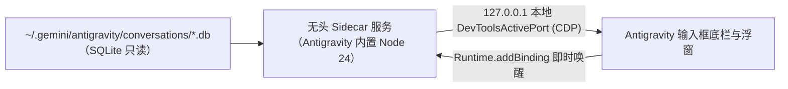

<div align="center">


# agy-ctx-ring（上下文胶囊）

**零侵入的 Antigravity 输入框底栏 HUD 与点击浮窗插件——实时展示会话统计、Token 用量与原生上下文 4 项精确构成。**

[](https://github.com/XMT-CN/agy-ctx-ring/releases/latest)
[](./LICENSE)
[](#工作原理与隐私说明)
[](#一键安装)

[English](./README.md) | **简体中文**

</div>

---

## 效果示意

直接挂载在 Antigravity 输入框底栏 `Turbo` 权限按钮左侧——无边框、响应式自动缩写，字体（Google Sans Flex）与亮/暗主题颜色完全跟随原生界面：

```text
+  Orchestrator ...      🕒 18 轮 402 步 · 172 tok/s   🛢 38M tok · 缓存命中 87%   ◔ 22%   🛡 Turbo ⌄   🎙   ✨
```

点击任意分段即可在输入框上方弹出详情卡片：

- **会话统计**：轮次、步数、模型耗时、工具调用壁钟耗时（区间合并去重）、平均首字延迟（TTFT）、输出速度（`tok/s`）。
- **Token 用量**：总用量、全局缓存命中率、未缓存输入、缓存读取与输出明细。
- **上下文窗口**：进度圆环与占用分级（`正常` / `占用偏高` / `接近上限`）、已用 / 剩余 / 窗口上限，以及直接解析自 Antigravity 原生 `gen_metadata` 的 **4 项构成明细**（系统提示与规则 · 工具调用与输出 · 模型思考与回复 · 用户输入）。

---

## 核心特性

- **不改 `app.asar`，版本升级不丢失**：绝不修改 `Antigravity.app` 或 `~/.gemini/config/config.json`，完全安装于标准插件目录 `~/.gemini/config/plugins/agy-ctx-ring/`，Antigravity 自动更新后无需重打补丁。
- **原生精确上下文构成**：直接解析 `gen_metadata` 内嵌的原生 `ctx[3]` protobuf 统计树，彻底告别截断日志字符数粗估造成的数倍偏差。
- **会话切换零延迟**：
  - 连接后后台自动预加载最近 40 个会话的指标到前端内存缓存；
  - 结合 Chromium `window.navigation`（`currententrychange`）、`popstate` 与 `queueMicrotask` 监听，切换会话**同帧秒出**；
  - 通过 CDP `Runtime.addBinding` 反向唤醒 sidecar，切换后约 5–15 ms 即同步最新 SQLite 状态。
- **新会话瞬时归零**：进入新会话（`/`）或 `.db` 尚未生成时立刻显示 `0 轮 0 步 · 0 tok · 0%`，不会串读上一条历史会话。
- **纯无头后台服务（`has_web_ui: false`）**：不在右上角或侧边栏产生多余 Tab，直接使用 Antigravity 内置 Node 24 运行时，零第三方 npm 依赖。

---

## 一键安装

### macOS / Linux

```bash
curl -fsSL https://raw.githubusercontent.com/XMT-CN/agy-ctx-ring/main/scripts/install.sh | bash
```

### Windows (PowerShell)

```powershell
irm https://raw.githubusercontent.com/XMT-CN/agy-ctx-ring/main/scripts/install.ps1 | iex
```

### 手动安装（`git clone`）

```bash
git clone --depth 1 https://github.com/XMT-CN/agy-ctx-ring.git ~/.gemini/config/plugins/agy-ctx-ring
bash ~/.gemini/config/plugins/agy-ctx-ring/scripts/install.sh
```

### 安装后启用步骤

1. 若 Antigravity 当前正以普通方式运行，请先**完全退出** Antigravity（`Cmd + Q` / 托盘退出）。
2. 使用脚本生成的 **`Antigravity (HUD)`** 启动 Antigravity：
   - **macOS**：打开 `~/Applications/Antigravity (HUD).app`（可直接固定到程序坞），或手动运行：
     ```bash
     open -a "Antigravity" --args --remote-debugging-port=0
     ```
   - **Linux**：从应用菜单启动 `Antigravity (HUD)`，或运行：
     ```bash
     antigravity --remote-debugging-port=0
     ```
   - **Windows**：双击桌面生成的 `Antigravity (HUD)` 快捷方式。
3. 打开 Antigravity 的 **Customizations → Plugins**，确认 **上下文胶囊 (`agy-ctx-ring`)** 处于开启状态。

---

## 工作原理与隐私说明



- **100% 本地只读**：使用 `{ readOnly: true }` 打开本地会话 `.db`，仅读取 `gen_metadata` 与 `steps`；**不修改任何数据库或 `config.json`，也无任何外部联网或统计上报**。
- **零外部依赖**：直接利用 Antigravity 自带 Node 24 的 `node:sqlite`、全局 `WebSocket` 与 `fetch`，无需安装任何依赖或编译原生模块。

---

## 升级与卸载

### 升级

重新执行对应系统的一键安装命令，或在使用 `git` 安装时执行：

```bash
git -C ~/.gemini/config/plugins/agy-ctx-ring pull --ff-only
```

之后在 **Customizations → Plugins** 重新开关一次插件（或重启 Antigravity）即可生效。

### 卸载

**macOS / Linux：**

```bash
bash ~/.gemini/config/plugins/agy-ctx-ring/scripts/uninstall.sh
```

**Windows (PowerShell)：**

```powershell
Remove-Item -Recurse -Force "$env:USERPROFILE\.gemini\config\plugins\agy-ctx-ring" -ErrorAction SilentlyContinue
Remove-Item -Force ([Environment]::GetFolderPath('Desktop') + '\Antigravity (HUD).lnk') -ErrorAction SilentlyContinue
```

> 卸载不会触碰 `Antigravity.app` 或 `~/.gemini/config/config.json`。

---

## 常见问题

<details>
<summary><strong>为什么需要用 <code>--remote-debugging-port=0</code> 启动器？</strong></summary>

为了做到零侵入且在 Antigravity 每次官方更新后不失效，插件不修改应用包内的 `app.asar`，而是通过本地仅回环监听的 `127.0.0.1` DevTools 端口（`DevToolsActivePort`）在运行时挂载 UI。使用 `Antigravity (HUD)` 启动器只是帮你自动带上 `--remote-debugging-port=0` 启动参数。

</details>

<details>
<summary><strong>为什么“窗口上限”显示 <code>512K</code> 或 <code>256K</code>，而不是模型的理论 <code>1M</code>？</strong></summary>

插件读取的是 Antigravity 下发给当前会话的原生上限字段（`ctx[4]`），即 Antigravity 实际用来触发上下文压缩（Compact）的红线（目前 Gemini 4 系列为 `512K`，部分 Flash 型号为 `256K`），与实际压缩时机严格一致。

</details>

<details>
<summary><strong>开启插件后输入框底栏没有显示数据条怎么办？</strong></summary>

请检查是否**完全退出**了旧进程，并通过 `Antigravity (HUD)`（或带 `--remote-debugging-port=0` 参数）启动；普通方式启动时 Chromium 不会创建 `DevToolsActivePort`，注入通道无法连接。macOS 推荐直接把 `~/Applications/Antigravity (HUD).app` 拖到程序坞长期使用。

</details>

---

## 目录结构

```text
agy-ctx-ring/
├── plugin.json                # Antigravity 插件清单
├── assets/
│   └── logo.svg               # 插件图标
├── sidecars/
│   └── ctx_ring/
│       ├── sidecar.json       # 无头 Sidecar 配置 (has_web_ui: false)
│       ├── main.mjs           # 守护进程入口
│       ├── telemetry.mjs      # 只读 SQLite 与原生 ctx[3] protobuf 解析器
│       ├── cdp_injector.mjs   # 本地 CDP 注入器 + Runtime.addBinding + 40 会话预加载
│       └── ui_shared.mjs      # 原生风格三段底栏与点击浮窗 UI
└── scripts/
    ├── install.sh             # macOS / Linux 一键安装与启动器脚本
    ├── uninstall.sh           # 一键清理卸载脚本
    └── install.ps1            # Windows PowerShell 安装与快捷方式脚本
```

## 开源协议

基于 [MIT License](./LICENSE) 开源。
